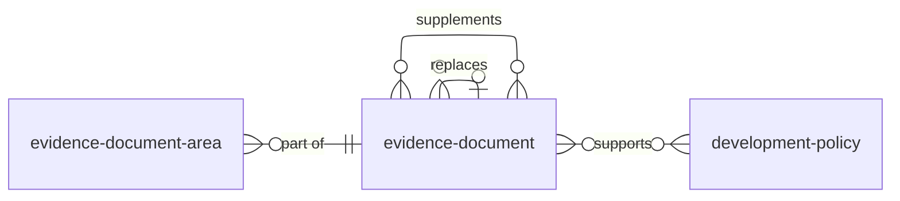

This page suggests how the evidence that supports a local plan might be recorded on planning.data. Changes to each dataset will be shown as diffs separately.

Documents that make up the plan itself, such as the local plan, stay in `development-plan-document` (see `policy_data_model.md`).

## Entity relationships



Codelists are listed separately below.

| Dataset | Typology | Status |
| :--- | :--- | :--- |
| `evidence-document` | document | Proposed, based on the existing `document` dataset |
| `evidence-document-area` | geography | Proposed |
| `evidence-document-type` | category | Proposed, with entries moved from `development-plan-document-type` |
| `evidence-document-role` | category | Proposed |
| `replacement-reason` | category | Proposed |
| `requirement` | category | Proposed |

## Common fields

Every dataset has these fields. They are not repeated in the tables below.

| Field | Type | Required | Notes |
| :--- | :--- | :--- | :--- |
| `reference` | string | yes | Unique within the dataset and persistent. |
| `name` | string | yes | |
| `notes` | text | | |
| `prefix` | string | yes | |
| `entity` | integer | yes | Assigned by planning.data. |
| `entry-date` | datetime | yes | When the record was created or changed. |
| `start-date` | datetime | | When it came into force. |
| `end-date` | datetime | | When it stopped being in force. Records are ended, not deleted. |

Field cardinality is 1 unless marked as a list.

## Evidence

### `evidence-document`

An evidence document produced or procured to support policies in a plan, such as a strategic flood risk assessment or a viability study.

| Field | Type | Required | Notes |
| :--- | :--- | :--- | :--- |
| `description` | string | | |
| `evidence-document-types` | string (list) | | From `evidence-document-type`. |
| `evidence-document-role` | string (CURIE) | | e.g. `evidence`. |
| `document-url` | url | | Link to the document. |
| `organisations` | string (list) | yes | Organisations the document belongs to. |
| `development-policies` | string (list) | | Policies the document was produced to support. A document can support many policies, so the link lives here rather than on the policy. |
| `requirements` | string (list) | | Legislation, NPPF paragraphs or local benchmarks the document addresses. |
| `baseline-data` | string | | Baseline formula or other information. To be defined. |
| `base-date` | datetime | | The date the evidence's data is as at. Often a year or more before `finalised-date`, and usually what matters for currency. |
| `commenced-date` | datetime | | When work on the document began. |
| `finalised-date` | datetime | | When the document was signed off. |
| `replaces` | string (CURIE) | | The `evidence-document` this edition replaces in full. Blank for a first edition. |
| `supplements` | string (list) | | Evidence documents this one adds to without replacing, e.g. an addendum, or a Level 2 SFRA alongside a Level 1. |
| `replacement-reason` | string (CURIE) | | Why this edition was produced. Only used with `replaces`. |
| `version-label` | string | | The publisher's own label, e.g. "v1.2". For display only; order comes from `replaces`. |

### `evidence-document-area`

Spatial data produced as part of an evidence document, such as bird flight paths, water studies or cave locations. Some is used only within the evidence; some goes on to inform `development-policy-area`. Fields to be confirmed.

| Field | Type | Required | Notes |
| :--- | :--- | :--- | :--- |
| `evidence-document` | string (CURIE) | yes | The evidence document the area comes from. |
| `geometry` | multipolygon | | Extent of the area. |
| `point` | point | | For data recorded as points. |
| `organisation` | string (CURIE) | yes | |

## Codelists

| Codelist | Purpose | Extra fields | Entries |
| :--- | :--- | :--- | :--- |
| `evidence-document-type` | Types of evidence document | `description` | Proposed, moved from `development-plan-document-type`: `strategic-flood-risk-assessment`, `strategic-housing-market-assessment`, `viability-assessment`, `sustainability-appraisal`. |
| `evidence-document-role` | The role a document plays | `description` | Proposed: `evidence` (justifies policy content, e.g. a viability study), `supporting` (accompanies the plan without justifying policy, e.g. a consultation statement). |
| `replacement-reason` | Why a new edition was produced | | Proposed: `scheduled-update`, `examination-request`, `national-change`, `consultation-response`, `correction`, `monitoring-cycle`. |
| `requirement` | Legislation and national policy evidence can address | | Proposed, e.g. `nppf-paragraph-160`, `flood-water-management-act-2010`. |

## Tracking editions

Each edition of an evidence document is its own `evidence-document` record, with its own reference, URL and dates. Editions are linked through `replaces` (full replacement) and `supplements` (additions that do not replace).

This differs from policies. A policy keeps one reference through plan-making, and its changes are tracked in fact history (see `policy_data_model.md`). An evidence edition is a distinct publication, so it gets a distinct record.

An older edition is not invalid once replaced. It may still be the evidence an adopted plan was examined against. Currency is shown by `end-date` and the `replaces` chain, not by marking records as superseded. "Superseded" is reserved for its statutory meaning for development plan policies.

### Limitation

`development-policies` links an evidence document to the stable policy, not to the policy at a particular plan-making stage. Which edition of the evidence supported which stage of a policy can only be inferred by comparing dates, such as the evidence's `finalised-date` against when the policy's `plan-event` changed.

If the optional `development-policy-version` dataset were adopted, each version would instead link to the evidence it relied on, through an `evidence-documents` field.

## Example

```json
{
  "entity": 4019283,
  "prefix": "evidence-document",
  "reference": "doc-lp-2026-flood-01",
  "name": "Strategic Flood Risk Assessment Level 1",
  "description": "Evidence base mapping spatial flood risk zones within the district boundary.",
  "evidence-document-types": ["strategic-flood-risk-assessment"],
  "evidence-document-role": "evidence",
  "document-url": "https://tottenham.gov.uk",
  "organisations": ["local-authority-eng:TOT"],
  "development-policies": ["policy-tot-2026-cc1", "policy-tot-2026-inf4"],
  "requirements": ["nppf-paragraph-160", "flood-water-management-act-2010"],
  "baseline-data": "",
  "base-date": "2025-03-31T00:00:00Z",
  "commenced-date": "2025-04-12T09:00:00Z",
  "finalised-date": "2026-02-10T16:30:00Z",
  "replaces": "evidence-document:doc-lp-2021-flood-01",
  "supplements": [],
  "replacement-reason": "replacement-reason:scheduled-update",
  "version-label": "v1.2",
  "notes": "Updated following Environment Agency consultation reviews.",
  "entry-date": "2026-10-11T14:00:00Z",
  "start-date": "2026-10-11T00:00:00Z",
  "end-date": ""
}
```

## Questions for co-design

- **Scope:** the proposed datasets cover procured evidence. Are datasets needed for public evidence sources, or for evidence that is not a document at all?
- **Existing `document` dataset:** should evidence be a new `evidence-document` dataset, or an extension of the existing `document` dataset?
- **Linking to policies:** if `development-policy-version` were adopted, should `development-policies` point to a policy version or the policy as a whole?
- **Requirements:** what legislation, national policy and other requirements should evidence be able to show it addresses?
- **Editions:** what values should `replacement-reason` hold?
- **Document areas:** should these hold both polygons and points? Where evidence goes on to inform a policy area, should the two be linked?
- **Baseline data:** what should `baseline-data` capture?
