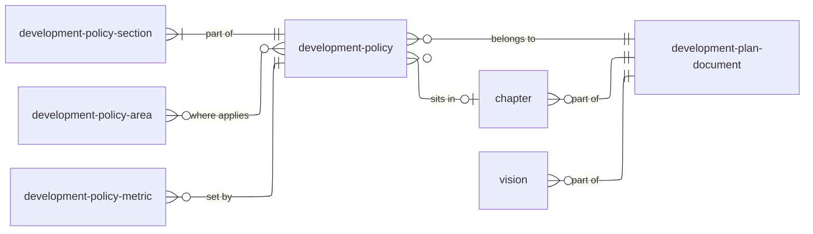

This page suggests how policies in a local plan might be recorded on planning.data. Changes to each dataset will be shown as diffs separately.

## Entity relationships



| Dataset | Typology | Status |
| :--- | :--- | :--- |
| `development-plan-document` | document | Existing, published |
| `development-plan-document-type` | category | Existing, published |
| `chapter` | – | Proposed |
| `vision` | – | Proposed |
| `development-policy` | policy | Existing draft, changes proposed |
| `development-policy-section` | – | Proposed |
| `development-policy-area` | geography | Existing draft |
| `development-policy-metric` | metric | Existing draft |
| `development-metric` | category | Existing draft, no entries |
| `development-policy-type` | category | Proposed |
| `development-policy-category` | category | Existing, published |
| `plan-event` | category | Existing, published, used as-is |

## Common fields

Every dataset has these fields. They are not repeated in the tables below.

| Field | Type | Required | Notes |
| :--- | :--- | :--- | :--- |
| `reference` | string | yes | Unique within the dataset and persistent. |
| `name` | string | yes | |
| `notes` | text | | |
| `prefix` | string | yes | |
| `entity` | integer | yes | Assigned by planning.data. |
| `entry-date` | datetime | yes | When the record was created or changed. |
| `start-date` | datetime | | When it came into force. |
| `end-date` | datetime | | When it stopped being in force. Records are ended, not deleted. |
| `organisation` | string (CURIE) | yes | Datasets published by authorities only, not national codelists. |

Field cardinality is 1 unless marked as a list.

## Plan

### `development-plan-document`

A document that makes up an authority's development plan, such as a local plan. No changes proposed.

| Field | Type | Required | Notes |
| :--- | :--- | :--- | :--- |
| `description` | string | | |
| `development-plan` | string (CURIE) | | The plan the document is part of. |
| `document-types` | string (list) | | From `development-plan-document-type`. |
| `document-url` | url | | Link to the document. |
| `documentation-url` | url | | Page on the authority's website that links to it. |

### `chapter`

A chapter of a development plan. Fields to be confirmed.

| Field | Type | Required | Notes |
| :--- | :--- | :--- | :--- |
| `development-plan` | string (CURIE) | yes | The plan the chapter is in. |
| `chapter-number` | string | | As shown in the plan, e.g. `5`. |
| `order` | integer | | Position within the plan. |

### `vision`

The plan's vision, which policies deliver. Can change during plan-making. Fields to be confirmed.

| Field | Type | Required | Notes |
| :--- | :--- | :--- | :--- |
| `development-plan` | string (CURIE) | yes | The plan the vision belongs to. |
| `text` | text | | The wording of the vision. |

## Policy

### `development-policy`

A policy in a development plan.

| Field | Type | Required | Notes |
| :--- | :--- | :--- | :--- |
| `reference` | string | yes | **Changed:** now a unique identifier, e.g. `policy-tot-2026-h3`. The plan's number moves to `policy-number`. |
| `policy-number` | string | | **New.** As shown in the plan, e.g. `H3`. |
| `description` | string | | Short summary of what the policy does. |
| `development-plan-document` | string (CURIE) | | The plan document the policy belongs to. |
| `chapter` | string (CURIE) | | **New.** |
| `development-policy-type` | string (CURIE) | | **New.** |
| `development-policy-categories` | string (list) | | Topics the policy covers. |
| `vision` | string (CURIE) | | **New.** |
| `plan-event` | string (CURIE) | yes | **New.** The plan-making stage the published policy represents. See [Tracking changes](#tracking-changes-through-plan-making). |

### `development-policy-section`

**New.** One record for each numbered or lettered part of a policy's wording or explanatory text. Replaces a single policy text field.

| Field | Type | Required | Notes |
| :--- | :--- | :--- | :--- |
| `reference` | string | yes | e.g. `policy-tot-2026-h3-a`. Stays the same as the plan progresses, even if relabelled. |
| `development-policy` | string (CURIE) | yes | The policy the section belongs to. |
| `section-type` | string | yes | `policy-wording` (binding wording) or `explanatory-text` (reasoned justification). |
| `label` | string | | As shown in the plan, e.g. `a`, `3.2`. Can change between stages. |
| `order` | integer | yes | Position within the policy. |
| `text` | text | yes | The wording of the section. |

`name` is not needed for sections.

### `development-policy-area`

The spatial area a policy applies to, such as a town centre or a tall buildings zone.

| Field | Type | Required | Notes |
| :--- | :--- | :--- | :--- |
| `development-policies` | string (list) | | Policies that apply to the area. |
| `plan-event` | string (CURIE) | | **New.** The plan-making stage the published boundary represents. |
| `geometry` | multipolygon | | Boundary of the area. |
| `point` | point | | |
| `document-url` | url | | |
| `documentation-url` | url | | |

### `development-policy-metric`

A measurable value set by a policy, such as 35% affordable housing.

| Field | Type | Required | Notes |
| :--- | :--- | :--- | :--- |
| `development-policy` | string (CURIE) | yes | The policy that sets the value. |
| `development-metric` | string (CURIE) | yes | The kind of measurement. |
| `value` | string | | e.g. `35`. |
| `period-start-date` | datetime | | Start of the period the value applies to. |
| `period-end-date` | datetime | | End of the period the value applies to. |

## Codelists

| Codelist | Purpose | Extra fields | Entries |
| :--- | :--- | :--- | :--- |
| `development-plan-document-type` | Types of plan document | `description` | Existing, e.g. `local-plan`, `site-allocations`. Proposed: `neighbourhood-plan`. Evidence types to move to a separate `document-type` codelist. |
| `development-policy-type` | Types of policy | `description` | Proposed: `strategic`, `non-strategic`. |
| `development-policy-category` | Policy topics | | [Existing list](https://www.planning.data.gov.uk/dataset/development-policy-category), e.g. `affordable-housing`, `design`. |
| `development-metric` | Kinds of measurement | **New:** `description` | Proposed: `affordable-housing-percentage`, `housing-requirement`. |
| `plan-event` | Plan-making stages | | [Existing list](https://www.planning.data.gov.uk/dataset/plan-event). |

## Example

A policy:

```json
{
  "entity": 5023417,
  "prefix": "development-policy",
  "reference": "policy-tot-2026-h3",
  "name": "Affordable housing",
  "policy-number": "H3",
  "description": "Sets the proportion of affordable housing required on residential developments.",
  "development-plan-document": "doc-lp-2026-local-plan-01",
  "chapter": "chapter-tot-2026-housing",
  "development-policy-type": "strategic",
  "development-policy-categories": ["affordable-housing"],
  "vision": "vision-tot-2026",
  "plan-event": "adopted",
  "notes": "",
  "organisation": "local-authority-eng:TOT",
  "entry-date": "2026-10-12T14:00:00Z",
  "start-date": "2026-10-12T00:00:00Z",
  "end-date": ""
}
```

Its sections:

| reference | development-policy | section-type | label | order | text |
| :--- | :--- | :--- | :--- | :--- | :--- |
| `policy-tot-2026-h3-a` | `policy-tot-2026-h3` | `policy-wording` | a | 1 | Residential developments of 10 or more homes will be required to provide at least 35% affordable housing. |
| `policy-tot-2026-h3-b` | `policy-tot-2026-h3` | `policy-wording` | b | 2 | Affordable housing should be provided on site unless off-site provision can be robustly justified. |
| `policy-tot-2026-h3-exp` | `policy-tot-2026-h3` | `explanatory-text` | 5.12 | 3 | The 35% requirement reflects the need identified in the Housing Needs Assessment. |

A metric it sets:

| reference | development-policy | development-metric | value |
| :--- | :--- | :--- | :--- |
| `metric-tot-2026-h3-ah` | `policy-tot-2026-h3` | `affordable-housing-percentage` | 35 |
