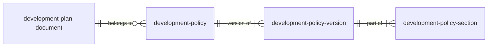

This is an **option for co-design**. It is a proposed dataset that does not currently exist in draft or published form.

The draft structured policy (see `policy_data_model.md`) tracks changes through plan-making using planning.data's fact history plus a `plan-event` field on the policy. This dataset would be added only if a national need to navigate and compare policies between stages emerged.

## Why it might be needed

On planning.data, each `reference` is one entity. When a record is republished with the same reference and a later `entry-date`, the new values become current and earlier values are kept in the entity's fact history.

This records each stage, but it does not make stages easy to navigate. Fact history is stored field by field, so seeing a policy at a past stage means looking up each field of the policy and each of its sections as at a date. This suits an audit trail, but is difficult for a user comparing stages. It also depends on publishers republishing a policy and its sections together, and ending removed sections rather than deleting them.

Each stage's plan is usually published as a document in `development-plan-document`, so the wording at each stage is available to read. What is missing is a structured, machine-readable way to compare stages, for example to see which criteria changed at examination.

## How it would work

Each stage of a policy becomes its own record, with its own reference, linked to the stable policy. Sections link to a version rather than to the policy, so each stage has its own set of sections. This fits planning.data conventions, as every record still has a unique reference.



## `development-policy-version`

| Field | Type | Cardinality | Required | Notes |
| ----- | ----- | ----- | ----- | ----- |
| `reference` | string | 1 | yes | e.g. `policy-tot-2026-h3-v2` |
| `development-policy` | string (CURIE) | 1 | yes | The stable policy this is a version of |
| `evidence-documents` | string (list) | n |  | Evidence documents this version relied on |
| `plan-event` | string (CURIE) | 1 | yes | The stage this version represents. Moves here from `development-policy` |
| `version` | integer | 1 | yes | Starts at 1 and increases at each stage |
| `notes` | text | 1 |  |  |
| `organisation` | string (CURIE) | 1 | yes |  |
| `prefix` | string | 1 | yes |  |
| `entity` | integer | 1 | yes | Assigned by planning.data |
| `entry-date` | datetime | 1 | yes |  |
| `start-date` | datetime | 1 |  | Date of the stage, e.g. publication or adoption |
| `end-date` | datetime | 1 |  | Date of the next stage, or when the adopted version stopped being in force. Blank if current |

## Changes to `development-policy-section`

| Field | Change | Notes |
| ----- | ----- | ----- |
| `development-policy-version` | Replaces `development-policy` | The version the section belongs to |
| `reference` | Changes meaning | Unique per version, e.g. `policy-tot-2026-h3-v2-a`, since sections repeat at every stage |
| `section-key` | New | Stable identifier for the section across stages, e.g. `h3-a`, so the same section can be compared. Name to be confirmed |

## Example

H3 at two stages, with criterion (b) reworded at Regulation 19:

| reference | development-policy | plan-event | version |
| :--- | :--- | :--- | :--- |
| `policy-tot-2026-h3-v1` | `policy-tot-2026-h3` | `reg-18-consultation` | 1 |
| `policy-tot-2026-h3-v2` | `policy-tot-2026-h3` | `reg-19-publication` | 2 |

| reference | development-policy-version | section-key | label | text |
| :--- | :--- | :--- | :--- | :--- |
| `policy-tot-2026-h3-v1-a` | `policy-tot-2026-h3-v1` | `h3-a` | a | Original wording of (a) |
| `policy-tot-2026-h3-v1-b` | `policy-tot-2026-h3-v1` | `h3-b` | b | Original wording of (b) |
| `policy-tot-2026-h3-v2-a` | `policy-tot-2026-h3-v2` | `h3-a` | a | Original wording of (a) |
| `policy-tot-2026-h3-v2-b` | `policy-tot-2026-h3-v2` | `h3-b` | b | Revised wording of (b) |

Seeing H3 at Regulation 19 is a filter on `development-policy-version`. Comparing stages means matching sections by `section-key`.

`plan-event` values are placeholders.

## Costs

- an extra dataset
- unchanged sections repeated at every stage
- more for authorities to publish

## Exchange between tools

Plan-making tools could exchange the same information as JSON, defined by a JSON Schema, in which each stage is a self-contained snapshot of the policy with its sections nested inside, plus metadata such as the stage and date. This is the same model as `development-policy-version`, with nesting in place of links between datasets. In JSON, sections can keep the same reference in every snapshot, so `section-key` is not needed.

Both approaches rely on policy and section references staying stable.

## Scope for co-design

* Is there a national need to compare policies between stages?
* Should `version` be kept, or is `plan-event` plus `start-date` enough to order versions?

### References
- `development-policy`, through its `development-policy` field.
- `evidence-document`, through its `evidence-documents` field.

### Referenced by
- `development-policy-section`, through its `development-policy-version` field.

## Example snapshot (JSON)

H3 at Regulation 19, as a tool might exchange it. Snapshot metadata sits at the top level, the policy and its sections are nested, and sections keep their stable references.

```json
{
  "reference": "policy-tot-2026-h3-v2",
  "development-policy": "policy-tot-2026-h3",
  "version": 2,
  "plan-event": "reg-19-publication",
  "start-date": "2026-06-01",
  "end-date": "",
  "entry-date": "2026-06-01T09:00:00Z",
  "content-hash": "sha256:9f2c…",
  "policy": {
    "reference": "policy-tot-2026-h3",
    "name": "Affordable housing",
    "policy-number": "H3",
    "description": "Sets the proportion of affordable housing required on residential developments.",
    "development-plan-document": "doc-lp-2026-local-plan-01",
    "chapter": "chapter-tot-2026-housing",
    "development-policy-type": "strategic",
    "development-policy-categories": ["affordable-housing"]
  },
  "sections": [
    {
      "reference": "policy-tot-2026-h3-a",
      "section-type": "policy-wording",
      "label": "a",
      "order": 1,
      "text": "Original wording of (a)"
    },
    {
      "reference": "policy-tot-2026-h3-b",
      "section-type": "policy-wording",
      "label": "b",
      "order": 2,
      "text": "Revised wording of (b)"
    }
  ]
}
```

`content-hash` is optional. It is a fingerprint of the policy and section content, so tools can tell whether anything changed between two snapshots without comparing every field.
